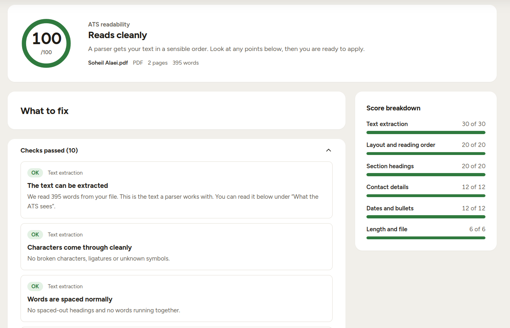
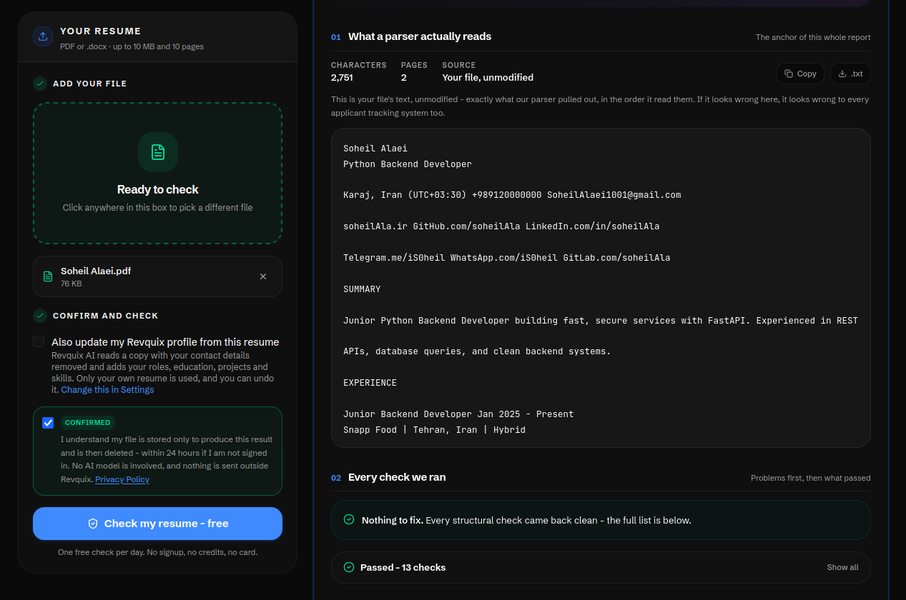
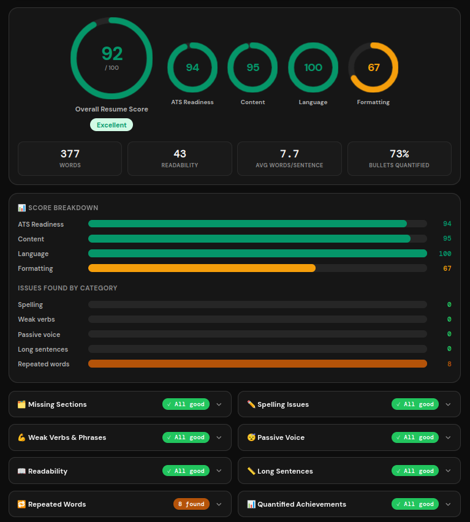

 <p align="center">
  
</p>

<h1 align="center">Nemud</h1>

<p align="center">
  <strong>English</strong>
  | <a href="README.md">فارسی</a>
</p>

Nemud is a resume template designed to help you create professional resumes quickly, with a focus on readability and ATS-friendly structure.

Instead of worrying about fonts, font sizes, spacing, or ATS compatibility, simply enter your information in a JSON file. Nemud takes care of the rest.

## ⁉️ The Problem

Most resume builders and templates give you plenty of freedom to customize the appearance of your resume. However, that freedom does not always lead to a better resume.

Unconventional section headings, inappropriate page layouts, and poorly thought-out customization can reduce readability and make it harder for ATS to read and extract information.

## ✨ Features

- A fixed, carefully designed layout with consistent typography, colors, spacing, and page margins for better readability
- A simple, single-column layout that improves readability and preserves information order during ATS parsing
- Easy editing of all resume content through a JSON file
- The ability to hide sections and change their display order
- Validation of resume data against a schema

## 🚀 Getting Started

### Run Locally

After installing Node.js and pnpm:

```bash
git clone https://github.com/soheilAla/nemud.git
cd nemud
pnpm install
pnpm dev
```

Open the URL displayed in your terminal in a browser to see your resume preview (probably [http://localhost:4321](http://localhost:4321)).

### Editing Resume Information

Your resume data goes in `config/cv.json`.

Available fields and their validation rules are defined in `config/cv.schema.json`.

### Configuring Section Order and Visibility

Use `config/site.json` to hide sections or change the order in which they appear.

### Profile Picture

Place your image inside the `config/` directory and set its path in the `basics.portrait` field in `cv.json`.

### Text Formatting

To **bold** part of your text, wrap it in double asterisks (`**`):

```json
{
  "summary": "You can bold **important text** with double asterisks."
}
```

### Exporting to PDF

**Automated export (requires Chrome):**

```bash
pnpm export
```

This builds the project and exports a PDF named after you in in the project root directory.

**Manual export:**

```bash
pnpm build
pnpm preview
```

In your browser, print the resume to PDF (`Ctrl + P` and select `Save to PDF` as the destination).

Make sure `Print headers and footers` is disabled so the browser does not add extra information to the PDF.

## ⚠️ ATS Compatibility

ATS (Applicant Tracking System) is software companies use to manage job applications. Nemud is designed to produce resumes that can be processed by these systems.

However, ATS platforms use different rules and methods to process resumes, so no template can guarantee 100% compatibility with all of them. Additionally, the quality of your resume content plays a significant role in achieving a high score in ATS evaluations.

Some validation results from ATS testing tools:
- [Alder CV ATS Checker](https://aldercv.com/ats-checker)

  

- [Revquix ATS Resume Checker](https://www.revquix.com/tools/ats-resume-checker)

  

- [Small Study Tools CV Review](https://smallstudytools.com/cv-review/)

  

## 📄 License

This project is licensed under the [MIT License](LICENSE).
